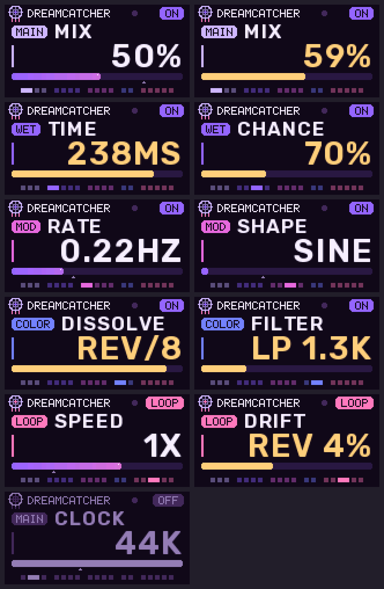

# Dreamcatcher

**An ambient texture firmware for the Valeton GP-5, built on [OpenGP5](https://github.com/OpenGP5/OpenGP5).** Version 1.0, on OpenGP5 0.2.0-alpha.
The first full firmware made with the OpenGP5 platform: its own sound engine on the DSP, its own controls and
screen on the control processor.



Dreamcatcher is inspired by two pedals: the Chase Bliss **MOOD MKII** (an always-listening micro-looper and a
CLOCK that sets the sample rate of everything) and the Old Blood Noise Endeavors **Parting** (moments of chance
letting sound into a glitch delay that smears into reverb, dissolves and jumps in octaves). It is an
independent project, not affiliated with or endorsed by Chase Bliss, Old Blood Noise Endeavors or Valeton, and
contains none of their code.

Your playing is recorded all the time. One press catches the last moments as a loop that plays back like tape
or is stretched into slow-moving slices. Alongside it, a wet channel lets bits of sound into a delay "by chance"
once per LFO cycle, smears them into reverb, jumps their clock in octaves, reverses or crushes them, modulates
and filters them. The loop can be routed into the wet channel, so the two halves feed each other.

> **Alpha.** Flashing custom firmware can go wrong. Read OpenGP5's
> [getting-started guide](https://github.com/OpenGP5/OpenGP5/blob/main/GETTING-STARTED.md), especially
> *Recovery*, before you flash.

## Controls

| control | does |
|---|---|
| turn PARA | choose a setting (the screen shows its section and value) |
| volume knob | changes the chosen setting once turned a little (the value turns gold while it follows) |
| foot switch | catch a micro-loop / let it go and listen again (the looper only) |
| click PARA | save the current sound into the active preset (`SAVED P3`). On PRESET with another slot highlighted by the volume knob (`LOAD P3`): load that slot, or, if it is empty, save the sound there |
| hold PARA 3 s | effect on / off (`OFF IN` counts down after 1 s). The looper is left alone: a caught loop stays caught, and is heard again when the effect is back on. While off, the output is the exact dry signal |

The LEDs glow violet when Dreamcatcher is on and dim red when it is off. The dot in the screen's header pulses at the LFO rate, like a "moment
of chance" light.

## Settings

| section | setting | range |
|---|---|---|
| MAIN | PRESET | slot 1 … 8, highlighted with the knob, loaded with a click of PARA; a bumped knob never changes the sound (`P3` = active, `P3*` = changed since saved, `LOAD P3` = highlighted, `3 EMPTY` = nothing saved). A preset holds every setting and VOLUME, not on / off or a caught loop. The pedal starts on the last slot you loaded or saved |
| | MIX | dry only … both full (middle) … wet only |
| | CLOCK | 1.4 kHz … 44 kHz in musical steps. The engine rate of both halves: lower = longer loops and delays, more grit. Changing it while a loop plays shifts the loop's pitch in harmonised steps |
| | VOLUME | output level |
| WET | TIME | delay time, 4 ms … 555 ms at 44 kHz (longer at lower CLOCK) |
| | SMEAR | diffusion and feedback: clean echoes … dense reverb |
| | CHANCE | below noon: chance per LFO cycle that something enters the delay (half the time new input, half the time the old output, fed back). Noon: input always enters (`ALWAYS`). Above noon: input always, plus a growing chance of feeding the old output back (`FB`, up to sound-on-sound) |
| | GLITCH | below noon: delay + LFO clock at HALF, NORMAL or DOUBLE speed (octave jumps). Above noon: a growing chance (`RND`) that each LFO cycle picks a new clock and crush rate at random |
| MOD | RATE | LFO rate, 0.05 … 12 Hz; also how often CHANCE decides |
| | DEPTH | modulation depth |
| | SHAPE | SINE, SQUARE, RAMP, SAW, RND SIN, RND SQR, ENV. With ENV your playing's loudness opens the delay instead of the LFO, and CHANCE becomes SENSE (sensitivity) |
| | MOD | TREMOLO or VIBRATO on the wet channel |
| COLOR | DISSOLVE | below noon: sample-rate crush (LOFI, bit loss in the lower half); noon CLEAN; above noon: the delay plays backwards, then at 1/2, 1/4, 1/8 speed (REV 1X, REV/2 …) |
| | FILTER | below noon low-pass 150 Hz … 13 kHz, noon OPEN, above noon high-pass 20 Hz … 2.5 kHz |
| LOOP | MODE | TAPE or STRETCH |
| | LENGTH | TAPE: loop length, 1/16 … all of the memory (0.74 s at 44 kHz, 24 s at 1.4 kHz). STRETCH: slice size |
| | SPEED / DRIFT | TAPE (SPEED): REV 4X … REV 0.5X, 0.5X … 4X. STRETCH (DRIFT): how fast the slices move: backwards … FROZEN (noon) … forwards; the ends are unstretched |
| | LOOP LV | level of the loop itself |
| | ROUTE | what the wet channel processes: IN (the guitar; loop in parallel), IN+LOOP, LOOP (the loop while it plays) |

A good start: catch a chord, set ROUTE to IN+LOOP, turn SMEAR up and CHANCE a little above noon, then roll
CLOCK down and play over it.

## Build and flash

You need what OpenGP5 needs (Python 3; on macOS Docker Desktop for the control processor's compiler; Linux / WSL
need the 32-bit C library; see OpenGP5's guide).

```
git clone --recursive https://github.com/OpenGP5/Dreamcatcher.git
cd Dreamcatcher
opengp5/release/setup-toolchain.sh      # once: fetches the two compilers into opengp5/fw-build/
./build.sh                              # -> build/GP-5_dreamcatcher.bin
python3 opengp5/tools/gp5tool.py flash build/GP-5_dreamcatcher.bin --sections all
```

On the pedal, `python3 opengp5/tools/gp5_link.py load` shows the DSP load: about 42 % with heavy settings on
the test unit (100 % = one 64-sample block's time).

Without a pedal:

```
./test.sh                                                          # sound engine + screen checks, build/screens.png
python3 opengp5/tools/run_effect.py . x out.wav --tone --set 10=240  # hear it: a plucked tone through Dreamcatcher
python3 opengp5/tools/dsp_emu_check.py build/GP-5_dreamcatcher.bin   # the built DSP code in an emulator
```

`--set ID=VALUE` sends a setting as the controls would; the ids are in `params.h`.

## How it is made

| file | what |
|---|---|
| `params.h` | the 19 settings both processors share (link command `0x7F10 [id][value]`) |
| `dsp/dream.h` | the sound engine (plain C, float; also runs on the computer) |
| `dsp/firmware.h` | connects it to the OpenGP5 DSP platform |
| `nds32/controls.c` | the controls, settings, value texts and presets (stored with OpenGP5's `gp5_store_save`) |
| `nds32/ui.c` | the purple 160 x 80 screen, drawn in bands |
| `nds32/font_aa.h` | anti-aliased large text: Rubik SemiBold, made with OpenGP5's `tools/make_font.py` |
| `nds32/firmware.c` | connects controls and screen to the OpenGP5 control platform; the LFO pulse |
| `opengp5/` | the platform, a git submodule pinned to a tested release (0.2.0-alpha) |

Two things learnt on the way, useful for any OpenGP5 firmware:

- **Big per-sample loops belong in RAM.** The DSP runs code straight from SPI flash. Dreamcatcher's 5 KB audio
  loop measured 110 % load from flash and about 42 % after `dsp/dream.h` put it in RAM (the `DC_HOT` macros:
  section `.data_hot`, copied to RAM at start-up with `.data`).
- **Large text** looks much better as pre-rendered anti-aliased glyphs than as a scaled-up pixel font:
  `opengp5/tools/make_font.py FONT.ttf font_aa.h NAME:CAP_HEIGHT[:SPACING] ... --notice "..."` (needs Pillow).

## Licence

MIT (`LICENSE`), except the font tables in `nds32/font_aa.h`, which are made from Rubik (Copyright 2015 The Rubik
Project Authors) and are under the SIL Open Font License 1.1 (`LICENSE-Rubik-OFL.txt`).
