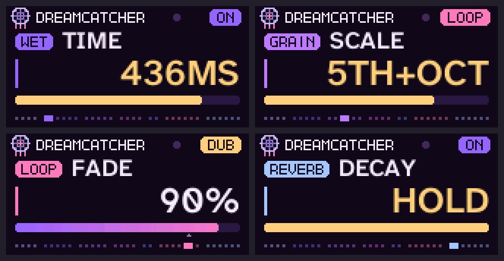

<h1 align="center">Dreamcatcher</h1>

<p align="center"><b>Ambient textures for the Valeton GP-5: an always-listening micro-looper, a glitch delay that smears into reverb, and grains.</b></p>

<p align="center">
  <a href="https://github.com/OpenGP5/Dreamcatcher/releases/latest"></a>
  <a href="https://github.com/OpenGP5/OpenGP5"></a>
  <a href="LICENSE"></a>
</p>

<p align="center">
  <a href="https://opengp5.github.io/docs/firmwares/dreamcatcher/"><b>User guide</b></a> ·
  <a href="https://github.com/OpenGP5/Dreamcatcher/releases/latest"><b>Download</b></a> ·
  <a href="https://opengp5.github.io/flasher/"><b>Flash from your browser</b></a> ·
  <a href="https://github.com/OpenGP5/Dreamcatcher/issues">Report a problem</a>
</p>

<p align="center"></p>

---

Dreamcatcher records your playing all the time. One press catches the last moments as a loop that plays back like
tape, or stretches into slow-moving slices. Alongside it, a wet channel lets bits of sound into a delay "by
chance", smears them into reverb, jumps their clock in octaves, reverses or crushes them. Grains read the delay and
can jump in pitch, play backwards or stutter, and a hall reverb holds it all. The loop can feed the wet channel, so
the two halves play off each other.

It was inspired by two pedals: the Chase Bliss **MOOD MKII** (an always-listening micro-looper, and a CLOCK that
sets the sample rate of everything) and the Old Blood Noise Endeavors **Parting** (moments of chance letting sound
into a glitch delay that smears into reverb). It is an independent project, not affiliated with or endorsed by
either company, and contains none of their code.

> [!NOTE]
> **Before you flash.** Flashing custom firmware can go wrong. Read
> [Before you flash](https://opengp5.github.io/docs/get-started/safety/) first. Installing Dreamcatcher over another
> firmware wipes that firmware's presets and files: back them up first.

## Install

- **With [OpenGP5 Launchpad](https://github.com/OpenGP5/Launchpad):** it comes with Dreamcatcher. Open **Flash**,
  choose Dreamcatcher, and flash. Launchpad also edits its presets while you play.
- **In your browser:** the [web flasher](https://opengp5.github.io/flasher/), in Chrome, Edge or Opera.
- **From a release:** download `GP-5_dreamcatcher.bin` from [Releases](https://github.com/OpenGP5/Dreamcatcher/releases/latest)
  and flash it with Launchpad (**Your own file**) or from the command line:
  ```bash
  python3 opengp5/tools/gp5tool.py flash GP-5_dreamcatcher.bin --sections all
  ```

Updating from an earlier Dreamcatcher keeps your presets.

## Controls

| Control | Does |
|---|---|
| **Turn PARA** | Choose a setting. The screen shows its section and value |
| **Volume knob** | Changes the chosen setting once you turn it a little. The value turns gold while it follows |
| **Tap the foot switch** | Catch a loop, or let it go and listen again |
| **Hold the foot switch** | While a loop plays: **overdub** into it until you let go (`DUB`). While listening: **freeze** the wet channel (`FRZ`) |
| **Click PARA** | Save the sound into the active preset (`SAVED P3`). On PRESET with another slot highlighted: load it, or save there if it's empty |
| **Hold PARA 3 s** | Effect on or off. A caught loop stays caught. While off, the output is the exact dry signal |

The LEDs glow violet when Dreamcatcher is on and dim red when it's off. The dot in the screen's header pulses with
the LFO, like a "moment of chance" light.

<p align="center"></p>

**A good start:** catch a chord. Set ROUTE to IN+LOOP, turn SMEAR up and CHANCE a little past noon, then roll
CLOCK down and play over it.

## Settings

Seven sections, 34 settings: **MAIN** (preset, mix, clock, tempo sync, volume), **WET** (the delay), **GRAIN**,
**MOD** (the LFO), **COLOR** (crush and filter), **LOOP** and **REVERB**.

<details>
<summary><b>Every setting</b></summary>

| Section | Setting | Range |
|---|---|---|
| MAIN | PRESET | Slots 1–8. Highlight one with the knob, load it with a click of PARA. `P3` is active, `P3*` changed since saved, `3 EMPTY` nothing saved. A preset holds every setting and VOLUME, not on / off or a caught loop. The pedal starts on the last slot you loaded or saved |
| | MIX | dry only … both full (middle) … wet only |
| | CLOCK | 1.4 kHz … 44 kHz in musical steps. The engine's sample rate: lower means longer loops and delays, and more grit. Changing it while a loop plays shifts the loop's pitch in harmonised steps |
| | SYNC | `FREE`, or `SYNC`: TIME, RATE, LENGTH (TAPE) and GRAIN become note values of BPM (`1/8.`, `1/4T`, `1 BAR` …), and the LFO keeps to the beat. Each offers only the values that fit at the tempo and CLOCK |
| | BPM | 40 … 240, the tempo SYNC follows. SYNC and BPM are saved with each preset |
| | VOLUME | Output level |
| WET | TIME | Delay time, 4 ms … 1.16 s at 44 kHz (up to 37 s at a lower CLOCK). With SYNC: 1/32 … 1 bar |
| | SMEAR | Diffusion and feedback: clean echoes … dense reverb |
| | TONE | Darkens the repeats each time round; `OPEN` at the top |
| | CHANCE | Below noon: the chance per LFO cycle that something enters the delay. Noon: input always enters (`ALWAYS`). Above noon: plus a growing chance of feeding the old output back (`FB`, up to sound-on-sound) |
| | GLITCH | Below noon: the delay's clock at HALF, NORMAL or DOUBLE speed. Above noon: a growing chance (`RND`) that each LFO cycle picks a new clock and crush at random |
| GRAIN | GRAIN | Grain size, 6 ms … 186 ms at 44 kHz. With SYNC: 1/64 … 1/16 |
| | PITCH | Chance a grain is pitched to an interval of SCALE. Fed back, pitched repeats stack into a shimmer |
| | SCALE | OCT UP, OCT DN, OCTAVES, 5TH+OCT, HARMONY |
| | REVERSE | Chance a grain plays backwards |
| | STUTTER | Chance a grain repeats the one before it |
| MOD | RATE | LFO rate, 0.05 … 12 Hz; also how often CHANCE decides. With SYNC: 1/32 … 4 bars per cycle |
| | DEPTH | Modulation depth |
| | SHAPE | SINE, SQUARE, RAMP, SAW, RND SIN, RND SQR, ENV. With ENV, your playing's loudness opens the delay and CHANCE becomes SENSE |
| | MOD | TREMOLO or VIBRATO on the wet channel |
| COLOR | DISSOLVE | Below noon: sample-rate crush (LOFI). Noon: CLEAN. Above noon: the delay plays backwards, then at ½, ¼, ⅛ speed |
| | FILTER | Below noon: low-pass 150 Hz … 13 kHz. Noon: OPEN. Above noon: high-pass 20 Hz … 2.5 kHz |
| LOOP | MODE | TAPE or STRETCH |
| | LENGTH | TAPE: loop length, 1/16 … all of the memory (1.47 s at 44 kHz, 47 s at 1.4 kHz); with SYNC 1/8 … 4 bars. STRETCH: slice size |
| | SPEED / DRIFT | TAPE (SPEED): REV 4X … REV 0.5X, 0.5X … 4X. STRETCH (DRIFT): how fast the slices move, backwards … FROZEN (noon) … forwards |
| | LOOP LV | Level of the loop, and what it feeds the effects |
| | FADE | Overdub: how much of the loop stays each pass, `REPLACE` … 100 % |
| | ROUTE | What the wet channel processes: IN (the guitar; the loop in parallel), IN+LOOP, or LOOP |
| REVERB | DECAY | 0.3 s … 27 s; at the top, `HOLD` sustains the tail and keeps new playing out |
| | MIX | None … on top of the effect (middle) … the reverb alone. The dry guitar stays dry |
| | SIZE | Room … big hall (turning it glides, like tape) |
| | PRE-DLY | 0 … 200 ms before the reverb starts |
| | MOD | Slow drift in the tail |
| | SHIMMER | An octave-up copy of the tail, fed back in |

</details>

## Bluetooth and MIDI

Dreamcatcher is a Bluetooth MIDI device (OpenGP5 1.0): connect to **OpenGP5** from a phone or tablet app, the
[phone remote](https://opengp5.github.io/remote/), or a Mac (Audio MIDI Setup › Window › Show MIDI Studio ›
Bluetooth). Phones don't list it in their Bluetooth settings: connect from the app. The same MIDI works over USB.

- **Program Change 0–7** loads presets 1–8 (an empty slot is ignored).
- **Controllers** set the settings, one controller each, value 0–127 over the setting's whole range, on any
  channel. Only MIDI's undefined controllers are used, so a controller's other messages (bank select, mod wheel,
  sustain) don't change anything.
- Launchpad works over Bluetooth too (editing, presets, backups); firmware updates need the USB cable.

<details>
<summary>The controllers</summary>

| CC | Setting | Group |
|---|---|---|
| 20 | Effect | Main |
| 21 | Mix | Main |
| 22 | Clock | Main |
| 23 | Catch | Loop (the foot switch's: not set by MIDI) |
| 24 | Mode | Loop |
| 25 | Length | Loop |
| 26 | Speed | Loop |
| 27 | Loop level | Loop |
| 28 | Route | Loop |
| 29 | Time | Wet |
| 30 | Smear | Wet |
| 31 | Chance | Wet |
| 85 | Rate | Mod |
| 86 | Depth | Mod |
| 87 | Shape | Mod |
| 88 | Mod type | Mod |
| 89 | Dissolve | Color |
| 90 | Glitch | Wet |
| 102 | Filter | Color |
| 103 | Grain | Grain |
| 104 | Pitch | Grain |
| 105 | Scale | Grain |
| 106 | Reverse | Grain |
| 107 | Stutter | Grain |
| 108 | Tone | Wet |
| 109 | Fade | Loop |
| 110 | Freeze | Loop (the foot switch's: not set by MIDI) |
| 111 | Overdub | Loop (the foot switch's: not set by MIDI) |
| 112 | Decay | Reverb |
| 113 | Reverb mix | Reverb |
| 114 | Size | Reverb |
| 115 | Pre-delay | Reverb |
| 116 | Reverb mod | Reverb |
| 117 | Shimmer | Reverb |
| 118 | Sync | Main |
| 119 | BPM | Main |

</details>

## What's new

| Version | Changes |
|---|---|
| 1.5.0 | On OpenGP5 1.0: Bluetooth MIDI (presets and every setting from a phone or computer), USB audio, the synced tempo exact |
| 1.4.0 | Tempo sync: SYNC and BPM, with note values for TIME, RATE, LENGTH and GRAIN |
| 1.3.0 | Preset names on the pedal; every setting is an OpenGP5 parameter, so Launchpad's editor and backups work through them |
| 1.2.0 | Grains with pitch, reverse and stutter; overdub and freeze; the hall reverb; twice the loop and delay time (the engine moves to the control processor); every setting live from a computer |
| 1.1.0 | The screen's lettering in Atkinson Hyperlegible Next |
| 1.0.x | First release: the looper, the wet channel, 8 presets |

Presets from every earlier version load and sound as they were saved (from before 1.4 they load as FREE at 120 BPM).

## Build from source

You need what [OpenGP5 needs](https://opengp5.github.io/docs/platform/setup/): Python 3, and Docker Desktop on
macOS or the 32-bit C library on Linux and WSL.

```bash
git clone --recursive https://github.com/OpenGP5/Dreamcatcher.git
cd Dreamcatcher
opengp5/release/setup-toolchain.sh      # once: the two compilers, into opengp5/fw-build/
./build.sh                              # -> build/GP-5_dreamcatcher.bin
python3 opengp5/tools/gp5tool.py flash build/GP-5_dreamcatcher.bin --sections all
```

Without a pedal:

```bash
./test.sh                                                             # sound engine and screen checks; build/screens.png
python3 opengp5/tools/run_effect.py . x out.wav --tone --set 10=240     # hear it: a plucked tone through Dreamcatcher
python3 opengp5/tools/dsp_emu_check.py build/GP-5_dreamcatcher.bin      # the built DSP code in an emulator
```

`--set ID=VALUE` sends a setting as the controls would; the ids are in `params.h`.

## How it's made

The sound engine runs on the control processor, with the controls and the screen. The DSP keeps the dry signal,
the hall reverb and the final mix, so the dry sound never waits for the engine.

| File | What |
|---|---|
| `dsp/dream.h` | The sound engine (plain C, float), and the final mix on the DSP |
| `dsp/hall.h` | The hall reverb: an 8-line feedback delay network at half rate, on the DSP |
| `dsp/firmware.h` | The DSP half: sends the guitar to the engine, mixes what comes back with the dry signal, exact bypass |
| `dsp/link_words.h` | The audio link's words: the guitar to the control processor, the effect's share back |
| `nds32/engine.c` | Runs the engine in the audio link's interrupt, once per block |
| `nds32/controls.c` | The controls, settings, value texts and presets |
| `nds32/ui.c` | The purple 160 × 80 screen, drawn in bands |
| `nds32/firmware.c` | Connects the controls and screen to the platform; the LFO pulse |
| `firmware.json`, `params.h` | Who it is (OpenGP5 1.0, 136 audio link words) and its settings as OpenGP5 parameters |
| `opengp5/` | The platform, a git submodule pinned to a tested release (1.0.0) |

<details>
<summary><b>Things learnt on the way</b>, useful for any OpenGP5 firmware</summary>

- **The DSP runs about 4–5 cycles per instruction** (32 cycles for a trivial loop step; its large and small RAM are
  equally fast). A full-rate 8-line reverb took more than the whole DSP; at half rate, with per-block updates, it
  takes about 36 % (`dsp/hall.h`).
- **The control processor is the faster one for float code.** The whole engine at its heaviest took 106–108 % of
  the DSP and 64 % of the control processor, which also has more RAM. So it runs there, over the audio link. The
  effect's share comes back three blocks later (about 4.4 ms); the dry signal stays on the DSP without that delay.
- **Big per-sample loops belong in RAM.** The DSP runs code straight from flash. Dreamcatcher's 5 KB audio loop
  measured 110 % load from flash and about 42 % from RAM (the `DC_HOT` macros in `dsp/dream.h`).
- **Large text looks much better smooth** than as a scaled-up pixel font. Dreamcatcher uses the platform's
  `gp5_draw_text` with Atkinson Hyperlegible Next ([Text and fonts](https://opengp5.github.io/docs/platform/fonts/)).

</details>

## Licence

MIT (`LICENSE`). The screen's lettering comes from OpenGP5 (Atkinson Hyperlegible Next, SIL Open Font License
1.1, in `opengp5/platform/nds32/fonts/`).

Not affiliated with or endorsed by Valeton, Chase Bliss or Old Blood Noise Endeavors. "Valeton" and "GP-5" are
Valeton's trademarks, used only to say which pedal this runs on.
